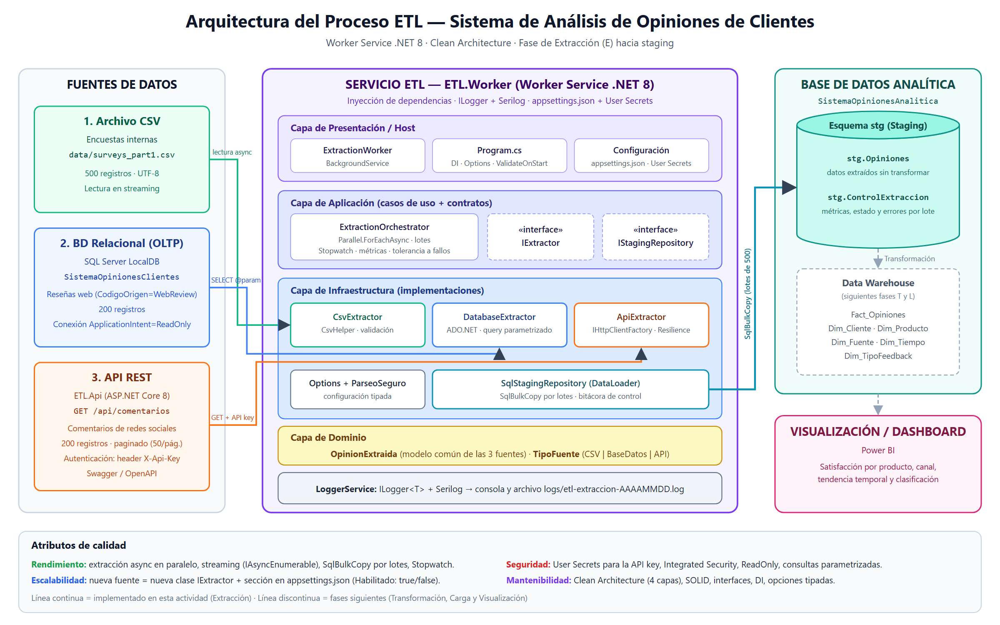
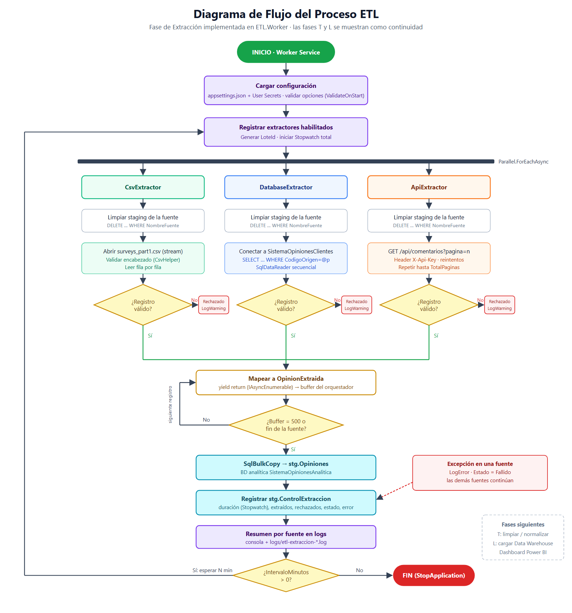

# Sistema de Análisis de Opiniones de Clientes (ETL con .NET 8)

Proceso ETL en **.NET 8** que integra opiniones de clientes desde tres fuentes heterogéneas (**CSV**, **base de datos relacional** y **API REST**) y las deposita en el área de *staging* de una **base de datos analítica** en SQL Server.

El repositorio contiene las siguientes etapas del proyecto:

| Etapa | Proyectos | Descripción |
|---|---|---|
| **Actividad 1 – Arquitectura y Extracción (E)** | `ETL.Domain`, `ETL.Application`, `ETL.Infrastructure`, `ETL.Worker`, `ETL.Api` | Worker Service con Clean Architecture que extrae de CSV, BD y API y guarda en `stg.Opiniones`. |
| **Carga de dimensiones del Data Warehouse** | `ETL.Worker`, `ETL.Application`, `ETL.Infrastructure`, `database` | Carga cinco dimensiones en el esquema `dw` a partir de staging y de los catálogos OLTP. |
| Carga de la BD transaccional (actividad anterior) | `ETL.Core`, `ETL.ConsoleApp` | Carga los CSV originales en la BD OLTP `SistemaOpinionesClientes`, que ahora es la **fuente relacional** del Worker. |

---

## 🏗️ Arquitectura



```
ETL.Domain          → Entidades (OpinionExtraida, TipoFuente). Sin dependencias.
ETL.Application     → Contratos (IExtractor, IStagingRepository) y caso de uso ExtractionOrchestrator.
ETL.Infrastructure  → CsvExtractor (CsvHelper), DatabaseExtractor (ADO.NET),
                      ApiExtractor (IHttpClientFactory), SqlStagingRepository (SqlBulkCopy).
ETL.Worker          → Worker Service (BackgroundService), DI, configuración y logging (Serilog).
ETL.Api             → API REST de comentarios de redes sociales (fuente externa simulada).
```

### Fuentes de datos

| Fuente | Tipo | Extractor | Origen |
|---|---|---|---|
| EncuestasInternas | CSV | `CsvExtractor` | `data/surveys_part1.csv` |
| ResenasWeb | Base de datos | `DatabaseExtractor` | `SistemaOpinionesClientes.dbo.OpinionesClientes` (CodigoOrigen = WebReview) |
| ComentariosSociales | API REST | `ApiExtractor` | `GET http://localhost:5080/api/comentarios` (header `X-Api-Key`) |

### Flujo del proceso



### Atributos de calidad

- **Rendimiento:** las fuentes se extraen en paralelo (`Parallel.ForEachAsync`), todo es asíncrono, los extractores entregan los datos en streaming (`IAsyncEnumerable`) y se insertan por lotes con `SqlBulkCopy`. Cada fuente se mide con `Stopwatch`.
- **Escalabilidad:** agregar una fuente = crear una clase que implemente `IExtractor` y una sección en `appsettings.json`. Cada fuente se activa o desactiva con `"Habilitado"`.
- **Seguridad:** la API key no está en el repositorio (User Secrets / variables de entorno), conexiones con `Integrated Security`, la fuente OLTP se abre con `ApplicationIntent=ReadOnly`, consultas parametrizadas y la API valida la clave en tiempo constante.
- **Mantenibilidad:** Clean Architecture, principios SOLID, interfaces, inyección de dependencias y opciones tipadas validadas al iniciar.

---

## 🚀 Cómo ejecutar

**Requisitos:** .NET 8 SDK, SQL Server LocalDB y la BD `SistemaOpinionesClientes` creada y cargada (`database/script_completo.sql` + `ETL.ConsoleApp`).

1. Crear la base analítica y las tablas staging:
   ```powershell
   sqlcmd -S "(localdb)\MSSQLLocalDB" -E -i database/staging_script.sql
   ```
2. Configurar la misma API key en ambos proyectos (no se sube a GitHub):
   ```powershell
   dotnet user-secrets set "Seguridad:ApiKey" "MI_CLAVE_SECRETA" --project ETL.Api
   dotnet user-secrets set "Fuentes:ComentariosApi:ApiKey" "MI_CLAVE_SECRETA" --project ETL.Worker
   ```
3. Iniciar la API (terminal 1) → Swagger en http://localhost:5080/swagger
   ```powershell
   dotnet run --project ETL.Api
   ```
4. Ejecutar el Worker (terminal 2):
   ```powershell
   dotnet run --project ETL.Worker
   ```
5. Validar en SQL Server con las consultas del final de `database/staging_script.sql`.

Los logs se guardan en `ETL.Worker/logs/etl-extraccion-AAAAMMDD.log`.

## Carga de dimensiones del Data Warehouse

Con `SistemaOpinionesClientes` cargada y `stg.Opiniones` poblada en `SistemaOpinionesAnalitica`, ejecutar desde la raíz del repositorio:

```powershell
sqlcmd -S "(localdb)\MSSQLLocalDB" -E -b -i database/dw_script.sql
dotnet run --project ETL.Worker -- --Etl:SoloDimensiones=true
sqlcmd -S "(localdb)\MSSQLLocalDB" -E -b -i database/dw_validacion.sql
```

Las dos bases deben estar en la misma instancia. El modo de dimensiones trabaja con los datos ya extraídos. El procedimiento `dw.CargarDimensiones` toma los clientes y productos del OLTP y deriva las fuentes por canal, las fechas y los tipos de feedback de staging. Los tipos de feedback también incorporan el catálogo OLTP. Cada dimensión tiene una clave sustituta y una restricción única sobre su clave de negocio.

La operación conserva las claves sustitutas y actualiza los atributos de clientes y productos en su fila existente (SCD tipo 1). Una transacción confirma las cinco dimensiones y la bitácora como una unidad. Si los insumos siguen iguales, repetir el comando registra cero inserciones y cero actualizaciones. El Worker registra los conteos por dimensión en `ETL.Worker/logs/etl-dimensiones-AAAAMMDD.log`.

---

## 📸 Evidencias de la actividad anterior (Carga de la BD transaccional)

### Ejecución exitosa del Proceso ETL


### Tablas pobladas en SSMS


### Consultas de validación e integridad referencial


